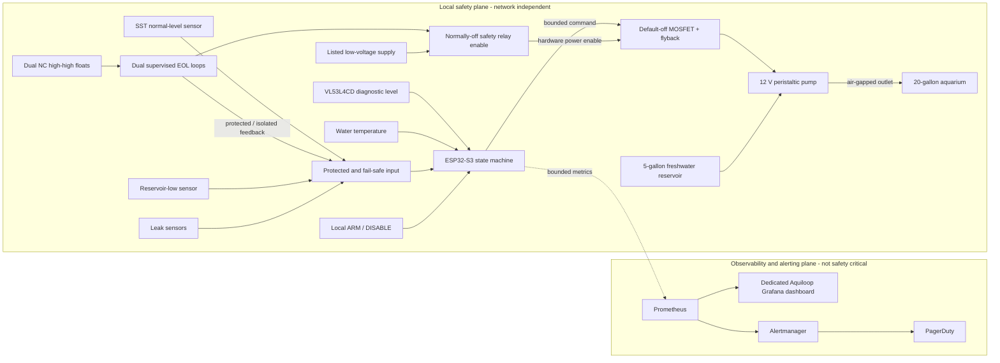

# Aquarium Auto-Top-Off System Design

**Status:** Design plus Phase 0 Arduino experiment; physical validation is pending.
**Target:** A 20-gallon garage aquarium supplied from a five-gallon freshwater
reservoir.
**Safety posture:** Phases 0 and 1 are **supervised experimental use only**. Unattended
operation is not considered until the Phase 2 exit criteria and the Phase 3
source-water/leak protection gates are met.

## 1. Problem statement

Evaporation lowers the waterline and concentrates dissolved constituents,
including increased salinity when the aquarium is saltwater. The system must
recognize a low waterline and move a bounded amount of freshwater
from a reservoir to the aquarium without creating a credible path for an
uncontrolled fill, siphon, electrical hazard, or network-dependent safety
failure. A garage adds heat, humidity, contamination, and temperature
variation. The design therefore starts small and supervised, then adds
independent containment, source and leak protection, and diagnostic sensing in
measurable phases.

## 2. Goals, assumptions, and non-goals

### Goals

- Restore the normal waterline with calibrated, short pump pulses.
- Make the pump default off on boot, reset, uncertain or contradictory input,
  watchdog expiry, controller failure, and loss of control power.
- Bound every attempt and cumulative delivery even in the minimal prototype.
- Add diverse, independent layers before permitting unattended use.
- Keep safety decisions local while exporting bounded telemetry for operations.
- Make every structural printed part reproducible from parametric OpenSCAD.

### Assumptions to validate on the installation

- The aquarium is nominally 20 US gallons and the source reservoir holds no
  more than five US gallons; usable safe delivery is determined by measured
  freeboard, not either label.
- Freshwater is appropriate top-off water. This system does not dose salt,
  medication, fertilizer, or food.
- The reservoir maximum water surface will stay below the delivery outlet. The measured
  vertical lift and tubing losses will be recorded before pump selection.
- A fixed bracket can reach a calm normal-level location and a separate higher
  location. Garage temperature and humidity ranges remain open measurements.
- Mains power terminates at an external, listed low-voltage supply; only
  protected low voltage enters the wet-area assembly.

### Non-goals

- Water changes, aquarium draining, continuous dosing, or precise depth control.
- Remote or scheduled unrestricted pump-on control.
- Using Wi-Fi, Kubernetes, Prometheus, Grafana, Alertmanager, or PagerDuty in a
  local shutdown path.
- Production firmware, dashboards, manifests, or cluster resources in Phase 0.
- A motorized sensor dipper or any other moving normal-level sensor.

## 3. Terminology

| Term | Meaning |
| --- | --- |
| **Normal level** | Desired waterline, detected by the fixed SST optical point sensor. |
| **Low/dry** | Debounced SST state that may request a bounded dispense attempt. |
| **High-high** | Abnormal upper level detected independently by either of the two Phase 2 float/reed sensors and their supervised channels. |
| **Safety plane** | Local sensing, state machine, hardwired cutoff, driver, and plumbing that prevent delivery. |
| **Observability plane** | Metrics, dashboards, alerts, and notifications; diagnostic only and never required to stop the pump. |
| **Attempt** | One bounded sequence of dispense pulses and settling observations. |
| **Daily budget** | Rolling 24-hour maximum commanded runtime and calibrated volume. |
| **Latched fault** | Persistent pump-inhibiting state requiring local inspection and manual reset. |
| **ARM/DISABLE** | Local maintained control that permits automatic attempts or positively inhibits them. ARM is permission, not a pump command. |

## 4. System context and safety-plane separation



The ESP32-S3 directly controls the pump because a microcontroller provides a
small, deterministic local control surface and hardware watchdog support. A
Raspberry Pi SBC would add an operating system, storage, and boot dependencies
without improving the primary safety path. Either Arduino-ESP32 or ESP-IDF is
acceptable after a Phase 1 spike, provided the same state-machine tests,
persistence semantics, and watchdog invariants are met.

Telemetry is one-way from the safety plane in normal operation. Configuration
changes must be bounded, validated, and preferably applied locally; no network
API exposes an unrestricted pump-on operation. Loss, delay, or compromise of
the observability plane cannot energize the driver or bypass any budget.

## 5. Core physical, electrical, and wet-environment design

### 5.1 Normal-level sensor

Phase 1 uses a SparkFun SST optical liquid point-level sensor fixed
**horizontally at the desired waterline** in a guarded holder on a top-rim
bracket. It is a binary wet/dry point switch, not a continuous depth sensor.
The mount is manually height-adjustable, then mechanically secured. It does not
point downward and does not dip: retained droplets can keep an optical tip
falsely wet after withdrawal, concealing a low level. Motorized dipping adds
motion, cable, alignment, and software failure modes without fixing that
retained-droplet ambiguity.

The SST requires **4.5-15.4 V** and has a push-pull output. The proposed SST
rail remains regulated **5 V**, separate from the **12 V pump rail**. It must never connect
directly to a 3.3 V ESP32 GPIO. The hardware design must choose and document one
qualified interface, including worst-case tolerances and powered-off behavior,
using manufacturer evidence. No replacement interface is selected here; the
existing divider remains unqualified under the section 8.1 gate. A pull resistor
on the ESP32 side establishes the configured
fault/inactive state for an open wire or unpowered sensor only after electrical
verification. Future firmware must inhibit on detectable uncertainty; the current
digital sketch cannot identify out-of-range voltage or distinguish wet from a
disconnected input with intact pull-down. Phase 2 adds a
separately wired, independently powered-down-safe high-high layer.

### 5.2 Pump, driver, and fluid path

- Select a 12 V peristaltic pump only after measuring reservoir-bottom-to-rim
  lift and routing losses. Its rated suction lift/head must exceed the measured
  worst case with margin, using the manufacturer's continuous/intermittent duty
  rating and compatible tubing.
- Drive it with a logic-level, default-off MOSFET stage. Use gate pulldown,
  current-appropriate wiring/connectors and fuse, and flyback protection at the
  inductive load. A hardware enable is added in Phase 2.
- Use an external listed low-voltage AC/DC supply sized for pump startup and
  electronics conversion. Fuse the low-voltage branches and never place exposed
  mains wiring in the project enclosure.
- Secure the outlet tube above the maximum aquarium waterline with a visible air
  gap to prevent aquarium backflow. The air gap does not stop gravity flow from
  a reservoir whose water surface is above the outlet: keep the reservoir's
  maximum source-water level below the delivery outlet, or use a separately
  validated, fail-safe anti-siphon mechanism. Do not submerge or loosely drape
  the outlet.
- Use GFCI-protected mains, drip loops on every cable/tube approaching powered
  equipment, strain relief, splash-resistant separation, and labeled DISABLE.
  Secondary containment becomes mandatory as the system matures.

### 5.3 Invariants

1. De-energized, booting, resetting, watchdog-expired, or failed control means
   pump off; GPIO defaults and gate pulldown must enforce this before firmware.
2. Missing, unstable, stale, impossible, or contradictory safety input means
   pump off and, after the allowed debounce, a latched fault.
3. A fill requires local ARM, healthy inputs, budget remaining, successful boot
   self-test, and (Phase 2+) both supervised high-high channels closed and
   in-range with valid safety-relay enable and feedback.
4. Every pulse, attempt, retry series, and rolling 24-hour delivery is bounded
   by both runtime and calibrated volume. No integer rollover or reboot resets a
   consumed budget.
5. The last pump state is never restored after reboot. A persistent fault and
   conservative delivery ledger are restored and checked first.
6. Only a deliberate local/manual action after inspection clears a latch.
7. Software cannot override the high-high hardware cutoff.
8. Network commands cannot produce unbounded or direct continuous pumping.

## 6. Firmware behavior

### 6.1 State-machine outline

For iterations 1b and 1c, the **lower SST is the normal-level fill-stop point**.
The upper SST is a diagnostic high-level guard, not a second fill target or the
independent Phase 2 high-high cutoff. The two-input contract below governs this
state machine; the existing one-input Phase 0 sketch does not implement it.

| State | Entry/action | Allowed transition |
| --- | --- | --- |
| **Boot self-test** | Force output off; verify configuration CRC/ranges, persistent fault and delivery ledger, reset cause, GPIO plausibility, sensors, watchdog, and ARM state. | `Idle` only when healthy and explicitly armed; otherwise `Maintenance` or `Latched fault`. |
| **Idle** | Pump off; sample both SSTs; account rolling budget. Lower wet/upper dry is normal. | Both dry to `Low debounce`; upper wet to `Latched fault`; DISABLE to `Maintenance`; uncertainty to fault. |
| **Low debounce** | Pump off; require both dry continuously for the configured sample count and minimum duration. | Confirmed both dry plus all enable conditions to `Filling`; lower wet/upper dry back to `Idle`; upper wet or uncertainty/time limit to fault. |
| **Filling** | Command one calibrated short pulse only while both SSTs are dry and watchdog, cutoff, input health, runtime and volume limits remain valid. | Lower wet/upper dry stops the pulse immediately to `Settling`; upper wet stops immediately to `Latched fault`. Normal pulse completion goes to `Settling`; any invariant breach stops and faults. |
| **Settling** | Pump off; retain the attempt and charged delivery; wait the full settling interval, then reassess both SSTs. | Lower wet/upper dry ends the attempt to `Idle`; both dry may return to `Low debounce` for a bounded retry; upper wet, uncertainty or exhausted attempt/retry/budget limits to fault. |
| **Maintenance** | Pump positively inhibited; allow local diagnostics and calibration steps, never unrestricted remote run. | Local ARM plus self-test to `Idle`; anomaly to fault. |
| **Latched fault** | Pump off; persist reason, counters, and timestamp/monotonic context; indicate locally and export telemetry. | Local reset only after DISABLE, inspection, healthy self-test, and documented acknowledgement. |

Exact constants are calibration outputs, not guesses. Configuration has hard
compile-time ceilings. Representative starting constraints for bench validation
are pulses of no more than 5 seconds, no more than 3 pulses per attempt, and a
mandatory settling interval of at least 10 seconds; installation calibration
must lower these where needed and establish safe volume limits from aquarium
freeboard. The task watchdog must be serviced only by a healthy control loop,
not blindly by a timer callback.

#### Two-SST pump permission and transition contract

Read each pair as **lower, upper** after the approved interface interpretation
(DRY = HIGH, WET = LOW). These are observed point-switch states, not verified
continuous height or wiring health. All start/continue permissions require local
ARM, healthy self-test, qualified inputs, no latch, valid persistence/watchdog,
remaining time/volume/retry budgets and all applicable safety enables. DISABLE,
reset, detected uncertainty or any safety fault overrides the table to pump off;
reboot never restores a running pulse or clears a latch/budget.

| Lower SST | Upper SST | Observed band | May start a pulse from off? | If a pulse is already active | Subsequent state |
| --- | --- | --- | --- | --- | --- |
| DRY | DRY | Below lower | Only after `Low debounce` confirms both dry and all enable conditions pass; after an earlier pulse, complete `Settling` first. | May continue only to the existing pulse deadline/volume cap while all enables remain valid. | On normal pulse completion, off to `Settling`; another pulse requires a fresh debounce and remaining retry/attempt/daily budgets. |
| WET | DRY | Between sensors; normal stop band | **No.** Keep off; do not fill toward the upper sensor. | **Stop on the first observed lower-wet sample**, without waiting for start debounce or the pulse deadline. | Off to `Settling`; if this pair remains after settling, end the attempt to `Idle`. If both become dry, re-debounce for a bounded retry; do not resume the interrupted pulse. |
| WET | WET | At/above upper; abnormal high | **No.** Inhibit and latch. | **Stop on the first observed upper-wet sample.** | `Latched fault` with high-level reason; inspection and local/manual reset required even if the pair later becomes normal. |
| DRY | WET | Contradictory pair | **No.** Inhibit and latch. | **Stop on the first observed upper-wet sample.** | `Latched fault` with contradiction reason; inspection and local/manual reset required even if the pair later becomes normal. |

Stop on a wet observation takes priority over pulse continuation in that control
iteration. Record the maximum sensing/control-loop stop latency and its possible
delivered volume before calibration; bound residual delivery and freeboard using
that latency. Start debounce may delay energizing, never delay this stop. Chatter
cannot extend a pulse deadline, erase charged delivery or replenish retries.
After any early stop, retain conservative pulse accounting and the full settling
interval. If a safe latency/volume bound cannot be established, keep the pump
disconnected. The 50 ms polling of the existing sketch is not this implementation
or proof of its timing. Missing/open wiring can still look wet; this contract
does not create fault diagnostics or independent overflow protection.

#### Iteration 1b acceptance tests before pump calibration

Use the future two-input implementation and **pretend-pump LED only**. Here
LED ON means pump commanded, unlike the Phase 0 wet-status LED. Exercise inputs
through reviewed safe fixtures or a host model; never directly short SST outputs
or bypass their mandatory voltage/power-off protection.

1. Record sensor spacing, normal stop height, configured dry debounce, maximum
   control-loop latency, settling time and all time/volume/retry limits. Test
   every table row from `Idle`, `Filling`, `Settling` and after reboot (16 cases).
   Every observed LED/state/latch result must match the table and default-off
   boot behavior; no pulse starts in either wet band or the contradiction.
2. Run five below-to-between fill simulations. Both dry starts only after the
   recorded debounce; lower wet/upper dry extinguishes the LED in the same
   control iteration and within the recorded latency. Keep upper dry throughout:
   the controller must not wait for upper wet. After settling in the between
   band, the attempt ends and the LED stays off.
3. While off and during a pulse, inject each upper-wet pair separately. Require
   immediate inhibition/stop, the correct fault reason, persistence through
   reboot, and no restart on returning to both dry. Only DISABLE, inspection,
   healthy self-test and deliberate local/manual reset may clear the latch.
4. Exercise both dry through normal pulse expiry and settling: retry only after
   a fresh debounce, with the previous delivery charged. Repeatedly toggle the
   lower input around wet/dry: verify immediate stops, full settling and no
   deadline, attempt, retry or rolling-budget reset. Test ordinary per-pulse
   runtime expiry and per-pulse volume-cap completion separately: each stops
   to `Settling` without a fault latch if no other fault limit is reached.
   Exhaust attempt runtime/volume, retry count and rolling daily runtime/volume
   limits separately: each inhibits further delivery and latches, including
   when coincident with normal pulse completion. A missed stop deadline is a
   fault, not normal expiry. Reaching wet never erases consumed delivery. Test
   DISABLE, watchdog, brownout and corrupt persistence.
5. Record five full fill/drain band cycles, including all four logical pairs
   via the safe test fixture for the contradictory case. Record expected/actual
   state, command, latency, charged volume, latch and reset for every case. All
   must pass before iteration 1c, including its first calibration pulse. Physical
   tests and this future implementation remain pending; model results alone do
   not establish hardware timing or electrical qualification.

### 6.2 Persistence and reset behavior

Use checksum/versioned nonvolatile records and wear-aware periodic commits. A
latched fault persists across power cycles. The rolling ledger conservatively
records a pulse before energizing it; an interrupted pulse is charged at its
maximum possible delivery. Missing/corrupt state inhibits ARM. Reset-cause and
boot-count telemetry help detect loops, but do not relax local behavior.

## 7. Sensor rationale and rejected alternatives

| Choice | Decision and rationale |
| --- | --- |
| Fixed SST optical point sensor | Phase 1 normal-level switch: compact and no moving parts. Fixed horizontal placement permits repeatable wet/dry behavior and inspection. Fouling, bubbles, film, wiring, and retained droplets remain credible failures. |
| Dual NC polypropylene float/reed switches | Phase 2 high-high cutoff channels. Each is normally closed below high-high and has a separately supervised end-of-line loop. High water or a wiring/power fault removes relay enable independently of firmware. Their buoyancy/mechanical failure modes differ from the optical sensor. |
| Two identical SST sensors | Rejected as the only redundancy: shared fouling, optical, mounting, supply, and interpretation failures can affect both. Diverse optical plus mechanical sensing improves failure independence. |
| Capacitive through-glass high sensor | A no-moving-sensor alternative when glass and geometry validate it. It avoids wetted moving parts, but shares sensitivity to wall thickness, condensation, deposits, nearby water, calibration drift, and electronics/common power; therefore its failure independence is weaker than a separately wired mechanical float. |
| Pressure/depth sensor | Deferred: wetted compatibility, drift, vent/reference handling, and extra penetrations are unnecessary for point control. |
| VL53L4CD time of flight | Phase 4 diagnostic continuous trend only. It does not replace discrete authoritative switches or the physical cutoff. |
| Motorized SST dipping/downward SST | Rejected unless future controlled evidence resolves retained-droplet false-wet behavior. Motion also adds jams, wear, cable fatigue, and timing assumptions. |
| Raspberry Pi direct controller | Rejected for primary control; its OS and storage expand failure and maintenance surfaces. It may host unrelated infrastructure, never the pump safety loop. |

## 8. Phased implementation plan

Costs are planning ranges in 2026 USD before shipping/tax, not quotations.

### 8.1 Phase 0 — SST water-detection hello world

**Status: existing external-LED sketch compile validation passed; electrical
qualification and all physical validation are pending.** The smaller iterations
below are a learning plan, not implemented firmware or completed experiments.
Phase 0 has no pump, relay, MOSFET, Wi-Fi, enclosure, or aquarium installation.
The existing sketch does not drive the onboard RGB LED or support two sensors.

Use a separate freshwater cup/bucket and keep electronics, USB, supplies, and
exposed conductors dry. Only the optical prism tip contacts water. Isolate all
power before rewiring. No actuator may be connected through iterations 0a-1b.
An LED result is never permission to operate unattended.

#### Small learning iterations and prerequisites

Each row inherits the preceding gates and hardware; its BoM is the smallest
addition, not a replacement inventory. Record date, board revision, firmware
revision, measurements, instrument uncertainty, and pass/fail for each gate.
Future firmware/CAD work must implement each missing capability separately.

| Iteration / objective | Smallest added BoM | Why it matters | Measurable pass criteria (all physical results pending) |
| --- | --- | --- | --- |
| **0a: board, USB, serial** | One ESP32-S3-DevKitC-1-N8R8 and known data-capable USB cable; computer reused. | Separate port, power, upload and serial learning from external wiring. Verify actual board/module and revision against its Espressif schematic before any GPIO instructions. | Record revision, connector and selected port; complete three upload/reset cycles and obtain the expected serial banner at 115200 baud each time, with no external circuit attached. Sensor text from a floating input is not evidence. |
| **0b: onboard RGB LED** | None beyond 0a. | Learn addressable LED control without breadboard wiring; distinguish RGB from the power LED. Use the verified revision's RGB pin and matching example, not generic blink assumptions. | A future board-only example displays red, green, blue and off in the recorded order for five cycles; serial confirms each command. No SST or actuator connected. |
| **0c: protected SST wet/dry bucket indication** | One LLC200D3SH-LLPK1, regulated 5 V sensor supply, breadboard/leads, mandatory per-channel interface/protection package below, freshwater cup/bucket, meter and transient-measurement access. Reuse onboard RGB/serial. | Learn datasheet limits, worst-case tolerances, verification before GPIO connection, and safe power-off behavior. The external LED is unnecessary for this step; protection is not optional. | Pass the electrical qualification gate first; then record at least five dry/wet/blotted-dry cycles and steady-state observations without unexplained transitions, plus the approved power-sequence tests. Future RGB indication must agree with serial. Existing firmware cannot distinguish disconnected sensor from wet. |
| **0d: separate external LED/resistor** | One ordinary LED and one separate 330 ohm, 1/4 W, 5% current-limiting resistor. Retain all SST protection parts. | Learn polarity, external current limiting and output wiring independently of sensor interfacing. | Verify LED current against selected LED and GPIO ratings; after 0c qualification, existing sketch reports dry/HIGH/LED off and wet/LOW/LED on for five cycles. No pump. |
| **1a: simple parametric hang-on-back mount** | Small PLA print and required fasteners/retainer; reuse one qualified SST channel. | Learn rim fit, secure horizontal tip placement, manual height adjustment and cable strain relief before moving water. | Commit editable OpenSCAD with rim thickness, offset, sensor fit and height parameters; render minimum/nominal/maximum intended fit cases; on the test vessel record ten wet/dry transitions and no slipping or height change during a supervised one-hour fit test. This is not long-term PLA qualification. |
| **1b: two sensors, adjustable spacing, pretend-pump LED** | Second SST plus its own complete qualified interface/protection package; parametric second holder/spacing; reuse external LED/resistor as pretend pump. | Learn discrete bands, disagreement, debounce and bounded state transitions without an actuator. Two identical optical sensors are not an independent overflow cutoff. | Pass the section 6.1 [two-SST acceptance tests](#iteration-1b-acceptance-tests-before-pump-calibration): both dry permits only debounced bounded pulses; lower wet/upper dry stops at the lower setpoint; either upper-wet pair stops and latches until manual reset. Record all 16 state/input cases and five fill/drain cycles, latency, timeout/volume budgets and chatter behavior. Do not claim continuous height or reliable open-wire detection. |
| **1c: supervised calibrated pumping** | Selected 12 V pump, tubing/secured outlet, fused default-off driver/flyback, listed supply/conversion, local ARM/DISABLE, containment and calibration vessel; retain regulated 5 V SST rail and every channel's protection. | Replace the pretend actuator only after proving bounds. Reservoir maximum water surface stays below the delivery outlet; secure outlet above maximum aquarium waterline. | Pass first-pump gate below, all Phase 1 tests and its 100-cycle exit criteria. Record calibrated runtime/volume bounds, pump-off flow, fault stops and manual reset. Observer remains present; no unattended use. |
| **2/3 observability iteration** | No new sensor required; reuse controller/network and existing Prometheus/Grafana infrastructure. Independent overflow, source and leak protection remain mandatory additions before unattended use. | Learn trustworthy telemetry and alerts after local states and limits exist. | Reconcile ten local events with telemetry; deliberately lose Wi-Fi, ingestion, dashboards and alert routing without changing shutdown/budgets; pass controller-down and runbook drills. Complete Phase 2 and Phase 3 protection gates before considering unattended use. |

Iterations 1a-1c belong to Phase 1; they do not authorize aquarium installation
before Phase 0 qualification. Their mount sources and PLA inspection policy are
in section 8.2. Two sensors report bands, never a continuous water height.

#### Required hardware and protection BoM

For **every SST channel**, including an onboard-RGB-only experiment, retain:

- One SparkFun SEN-13835 / SST LLC200D3SH-LLPK1 and a **regulated 5 V** sensor
  rail whose actual tolerance, startup and shutdown behavior must be qualified.
  The **12 V rail is for the later pump**, not this input circuit.
- One complete voltage-interface and power-off-protection package, with its
  rated parts and quantities recorded before assembly. This is mandatory and
  currently **selection/qualification pending**, not an optional accessory.
- The existing analysis candidate is **three 10 kohm, 1/4 W, +/-5% resistors per
  channel**: one upper and two series lower (20 kohm), also providing a lower-leg
  pull-down. These resistors alone are **not a qualified protection package**.
  Keep them in the candidate BoM until a reviewed replacement supersedes it;
  any additional protection or replacement interface needs manufacturer evidence.
- Breadboard/leads or rated connectors, defined ground/reference routing and
  strain relief. Reuse a meter; arrange appropriate transient measurement to
  assess noise/overshoot. Measurements are required, not optional.

The optional **external indicator** adds one LED and its **separate 330 ohm,
1/4 W, +/-5% resistor**; this is not an SST divider/protection resistor. Omitting
the external LED removes only those two items. Board, USB cable, freshwater
test vessel and measurement equipment are shared. No new buffer, clamp,
isolator, capacitor or wiring recipe is selected by this document. Final parts,
ratings and cost remain open until manufacturer-supported interface review.

#### Electrical qualification gate - before any GPIO connection

The previous direct assembly recipe is withdrawn pending qualification. Do not
connect the candidate divider to GPIO4 or any ESP32 input for initial tests.
Never connect raw SST output to a GPIO, supply the SST from 3.3 V, or reuse this
divider at 12 V. Do not tie bench +5 V to the board's 5 V pin while USB powers it.

**Read the exact parts first.** The [SST LLC200D3SH-LLPK1 datasheet,
DS-0141 rev 1](https://cdn.sparkfun.com/datasheets/Sensors/Infrared/DS0141rev1_LLDigital-LLC200D3SH-LLPK1.pdf)
specifies 4.5-15.4 V supply, push-pull HIGH in air, and output values at 100 mA:
HIGH has at most a 1 V drop from supply; LOW is at most 0.5 V. Its red/green/blue
leads are supply/output/ground. The analysis below assumes dry output from
Vs - 1 V to Vs and wet output from 0 to 0.5 V. Confirm the output limits apply
at the actual divider load, temperature and transients; the stated test load
does not establish every application condition or powered-off behavior.

The [ESP32-S3 datasheet v2.2, section 5.4, Table 5-4](https://www.espressif.com/sites/default/files/documentation/esp32-s3_datasheet_en.pdf)
gives HIGH minimum **0.75 x VDD**, upper input operating bound **VDD + 0.3 V**,
and LOW maximum **0.25 x VDD** (lower bound -0.3 V), where VDD is the respective
GPIO power domain. Table 5-1's 3.6 V **input power-pin** absolute maximum is not
a complete GPIO qualification. The DC table is specified at 3.3 V, 25 C; its
limits are not proof of safe input injection when unpowered.

**Reproduce the tolerance calculation.** Let Ru be the 10 kohm upper resistor
and Rl the sum of the two lower resistors; Vnode = Vout x Rl / (Ru + Rl).
With independent +/-5% tolerances, kmin = 19 / (10.5 + 19) = 0.644068 and
kmax = 21 / (9.5 + 21) = 0.688525. The lower pair's worst-case sum is 19-21 kohm;
do not assume their errors cancel.

| Assumed rails / corner | Calculated node | Relevant bound / result |
| --- | --- | --- |
| Exactly Vs = 5.00 V, VDD = 3.30 V, dry minimum | 4 x kmin = 2.57627 V | HIGH minimum 2.475 V; only **0.10127 V margin** before noise/load effects. |
| Same exact rails, dry maximum | 5 x kmax = 3.44262 V | Upper bound 3.600 V; 0.15738 V margin. |
| Same exact rails, wet maximum | 0.5 x kmax = 0.34426 V | LOW maximum 0.825 V. |
| Vs = 4.75 V (-5%), VDD = 3.30 V | 3.75 x kmin = 2.41525 V | Below HIGH minimum by 0.05975 V. |
| Vs = 5.25 V (+5%), VDD = 3.30 V | 5.25 x kmax = 3.61475 V | Above upper bound by 0.01475 V. |
| Vs = 4.75 V, illustrative VDD = 3.465 V (+5%) | 2.41525 V | HIGH minimum 2.59875 V; fails by 0.18350 V. |
| Vs = 5.25 V, illustrative VDD = 3.135 V (-5%) | 3.61475 V | Upper bound 3.435 V; fails by 0.17975 V. |
| Accidental Vs = 12 V, nominal ratio 2/3 | Dry 7.333-8.000 V | Incompatible with this ESP32 interface. |

The illustrative VDD tolerances are not measured board specifications. An exact
bench display is not an exact rail. This static calculation omits resistor drift,
output loading, leakage, ground offset, startup, cable pickup and overshoot.
The present circuit is **unqualified**, even though one nominal calculation fits.

**Measure and review before connection.** Record exact board revision and
schematic, supply min/max and uncertainty, GPIO-domain rail under load, output
limits, resistor values/tolerances, noise and transient envelope. Keep the MCU
input physically isolated while checking the sensor/interface node into an
appropriate representative load. Check dry, wet, disconnect, startup/shutdown,
brownout, and both independent power orders. Do not intentionally expose the
GPIO to an out-of-range signal to test it. Define positive HIGH/LOW and upper/
lower voltage margins including all uncertainties before accepting results.

**Power-off is a separate gate.** With sensor on and MCU off, a divider can
drive the dead input and backfeed its supply. A pull-down and a preferred manual
power sequence do not prove safety against unplugging or a supply failure.
Review manufacturer-supported powered-off input, injection/current and reverse-
power limits for the selected interface and board; prove safe behavior with
either rail absent, including MCU on/sensor off. No GPIO connection until the
reviewed solution covers these states and the measured envelope passes. Unknown
limits keep the gate open; no unverified substitute component is recommended.

#### Firmware and physical evidence

The practical [experiment README](../../firmware/auto_top_off/experiments/sst_led/README.md)
retains the existing sketch settings and a pending validation record. Its
GPIO4 input and GPIO5 external output require verification against the actual
board before use. For onboard RGB, consult the matching Espressif
[v1.0 guide](https://docs.espressif.com/projects/esp-dev-kits/en/latest/esp32s3/esp32-s3-devkitc-1/user_guide_v1.0.html)
or [v1.1 guide](https://docs.espressif.com/projects/esp-dev-kits/en/latest/esp32s3/esp32-s3-devkitc-1/user_guide_v1.1.html):
their RGB connections differ. Do not infer revision from N8R8 memory marking.

The existing digital-only sketch polls every 50 ms and reports initial state
and changes; it cannot diagnose analog overvoltage or distinguish a disconnected
sensor with intact pull-down from wet. LOW maps to WET/LED on, HIGH to DRY/LED
off. Sensor-power loss is expected to pull low only if the unpowered output
does not defeat that bias; this remains a measurement gate. These are intended
interpretations, not proof of fault detection or electrical safety. A broken
lower leg/ground can behave differently. No physical result is claimed here.

#### First-pump gate (iteration 1c)

Before replacing the pretend-pump LED, qualify both SST channels, implement and
pass the [two-SST acceptance tests](#iteration-1b-acceptance-tests-before-pump-calibration)
and Phase 1 state machine. Calibrate to the **lower SST stop point**, never a
fill-to-upper interpretation. Record positive **runtime and calibrated
volume** ceilings for pulse, attempt, retries and rolling 24 hours. The section
6 ceilings (at most 5 s per pulse, 3 pulses/attempt, at least 10 s settling) are
upper bounds to lower after calibration, not authorization for a first run.
Use a supervised non-livestock test vessel and a source volume smaller than its
measured safe freeboard; account for residual tube delivery. Establish an initial
conservative delivery bound from pump evidence before even the first calibration
pulse. Missing calibration/configuration means no automatic pumping.

Prove default-off at boot/reset, loss of control power and watchdog expiry,
timeout stop, exhausted-volume inhibition, persistent fault/budget across power
cycles, local DISABLE, and inspection plus manual reset after a latch. Require
an observer within reach of power removal for every powered pump test.

Daniel's accepted placement is reservoir **maximum water surface below the
delivery outlet**, with that outlet secured above the aquarium's maximum
waterline and a visible air gap. At worst-case source fill and installed tube
routing, collect and measure delivery after pump-off and power removal; record
test duration and residual volume against the calibrated allowance, with no
continuing gravity flow. Do not assume a peristaltic pump or check valve seals.
Repeat after tube/outlet changes. Independent overflow cutoff, source-low and
leak protection plus containment must pass before unattended use is considered.

### 8.2 Phase 1 - supervised minimal prototype

**Classification: SUPERVISED EXPERIMENTAL USE ONLY; NOT FOR UNATTENDED
OPERATION.** It lacks an independent high-water cutoff, reservoir-low detection,
and leak detection. A person capable of pressing DISABLE and disconnecting
power remains present throughout every armed test. During testing, fill the
reservoir with no more water than measured aquarium freeboard can safely accept,
even if that amount is far below five gallons.

#### Included hardware/software

- ESP32-S3 development board; regulated 5 V SST rail and separately qualified
  interface/protection for each SST channel; separate 12 V
  peristaltic pump selected from measured lift; default-off fused MOSFET/flyback
  driver; listed supply and 12-to-5/3.3 V conversion as required.
- Local maintained ARM/DISABLE control and simple local status (power/armed,
  pump, and fault LEDs or similarly unambiguous indicators).
- Fixed, manually height-adjustable top-rim bracket and horizontal SST guard;
  no motors or moving sensors.
- State machine, debounce, calibrated pulses, settling, bounded retries,
  per-attempt runtime/volume, rolling daily budget, watchdog, persistent latch,
  and conservative reboot behavior described above.
- GFCI, drip loops, fused low voltage, air-gapped secured outlet, strain relief,
  and reservoir maximum water surface below the delivery outlet.

Iteration 1b adds a second SST for band learning; it does not replace the
Phase 2 diverse high-high cutoff. The present one-input sketch cannot implement
that iteration or Phase 1 pump control.

#### Phase 1 printed-part inventory and exact planned source

Every structural component is printed in **PLA** in this phase. Each row is a
required editable source; optional STL output is never the sole CAD artifact.

| Component | Planned parametric source | Purpose |
| --- | --- | --- |
| Electronics enclosure body/lid | `tools/auto_top_off/enclosure.scad` | Splash-resistant separated housing, ventilation strategy, fasteners, strain relief. |
| Aquarium rim bracket/clamp | `tools/auto_top_off/rim_bracket.scad` | Manual height adjustment and secure top-rim attachment. |
| SST holder, optical-tip guard and adjustable second-sensor spacing | `tools/auto_top_off/sst_sensor_holder.scad` | Fixed horizontal alignment; shields bumps without trapping water at the tip. |
| Pump mount and vibration feet | `tools/auto_top_off/pump_mount.scad` | Secures the selected pump above containment where possible. |
| Air-gap outlet-tube clip | `tools/auto_top_off/outlet_tube_clip.scad` | Locks tubing above maximum waterline and prevents submersion. |
| Reservoir lid insert/grommet | `tools/auto_top_off/reservoir_lid_insert.scad` | Routes suction tube without sealing the vent or weakening the bucket. |
| Cable/tube clips and labels | `tools/auto_top_off/cable_management.scad` | Drip-loop routing, strain relief, and identification. |
| Shared dimensions/material values | `tools/auto_top_off/parameters.scad` | Tank rim, tubing, fastener, clearance, and print-shrink parameters. |
| Reusable geometry | `tools/auto_top_off/lib/common.scad` | Rounded mounts, captive-nut features, clips, and validation helpers. |
| Assembly/part selector | `tools/auto_top_off/auto_top_off.scad` | Preview and select reproducible part outputs. |

PLA is a deliberate prototype constraint, not a durability claim. Garage heat
can approach PLA's softening range; sustained clamp loads cause creep; humidity,
splashes, cleaning chemistry, and cyclic stress can change fit or promote
cracking. Keep printed parts away from heaters and electrical hot spots. Inspect
before every supervised session for softness, whitening, cracks, warping, loose
fasteners, delamination, water traps, biofilm, and loss of outlet air gap.
Replace immediately on any change; otherwise replace load-bearing/wet-adjacent
prototype parts after three months or 100 pump cycles, whichever comes first,
until evidence supports a shorter interval. Never use a printed part as the
only barrier against overflow or electric shock.

#### Failure modes addressed

Ordinary evaporation; short SST chatter; stuck
firmware task; reboot during a fill; accidental long command; limited pump/tube
movement; some outlet siphon risk.

#### Remaining limitations

Common-controller and sensor failures; optical
fouling/false wet; stuck MOSFET; no physical high cutoff; empty reservoir; leak,
blocked/kinked tubing, calibration drift, structural creep, or remote alarm.

#### BOM delta

Previous Phase 1 planning ranges were $60-$190 incremental and $105-$265
cumulative; these are incomplete until qualified interface parts and the second
SST are costed. Retain the Phase 0 mandatory per-channel protection BoM (including
the three-resistor candidate until superseded) and regulated 5 V sensor supply;
iteration 1b adds one SST and one complete protection package. The 330 ohm LED
resistor stays a separate indicator item. Through iteration 1b, the cumulative
sensor inventory is two SSTs and two complete qualified protection packages
(six candidate 10 kohm resistors until superseded), reusing one board and
indicator. The second SST was not included in the old totals.

Other Phase 1 additions are pump (1, historical $20-$60),
driver/protection/converter parts (1 set, $10-$30), listed supply
(1, $15-$35), ARM control/indicators/connectors/fuse
(1 set, $10-$20), tubing/check-compatible fittings without relying on a check
valve for safety (1 set, $5-$15), and PLA/fasteners (1 set, $10-$25).

#### Validation tests

1. Measure maximum lift and verify pump startup/flow at that lift; collect timed
   pulse samples at low/mid/high reservoir levels and bound worst-case volume.
2. With pump disconnected, exercise dry/wet/chatter/open/short/unpowered sensor,
   boot, brownout, reset, corrupt persistence, watchdog, budget, and local latch.
3. With the safely limited reservoir and an observer, verify pulse/settle/retry,
   manual DISABLE, freeboard, air gap, outlet retention, maximum source-water
   level below the delivery outlet, and power removal.
4. Soak and splash-test unpowered printed fixtures; inspect clamp creep over the
   expected garage temperature range. Never intentionally wet energized parts.
5. Review source-to-part mapping and render every `.scad` in CI once implemented.

#### Objective exit criteria

100 consecutive supervised demand cycles without
an invariant breach; all injected faults keep the pump off or stop it within one
bounded pulse; worst-case daily budget is below measured safe freeboard with
margin; power-cycle/latch persistence passes 20 consecutive trials; mount and
air gap remain secure; calibration and test records are reviewed. Passing Phase
1 does **not** authorize unattended use.

### 8.3 Phase 2 - redundant sensing and hardware cutoff

#### Included hardware/software

- Add two independently mounted, aquarium-compatible polypropylene
  normally-closed high-high float/reed sensors above the normal SST setpoint.
- Give each float a separate, firmware-independent supervised end-of-line loop
  with a distinct EOL resistance and its own safety-controller channel. The
  controller must require both channels to be in their closed, in-range state
  and use channel test pulses or equivalent cross-short monitoring. High water,
  an open/broken wire, connector removal, lost loop or relay power, a
  short-to-supply/ground or cross-channel short, or a conductor bridge that
  bypasses either NC contact must make at least one channel invalid and
  de-energize the normally-off safety relay. The future circuit design must
  document resistance windows, tolerances, test coverage, reset behavior, and
  single-fault analysis; this document does not provide a schematic.
- Relay de-energization physically removes pump power outside firmware. Select
  a force-guided/safety-rated controller and relay architecture where
  practicable, verify contact ratings, and switch the pump power-enable path
  rather than motor current through either sensor.
- Feed separately protected or isolated channel state and relay auxiliary
  feedback to the ESP32, without allowing GPIO faults to hold the safety loop
  valid. Channel disagreement, an invalid loop, a normal-low/high-high
  contradiction, stale feedback, or relay mismatch latches a fault and drives
  the `high_high` metric. Reset is explicit and local/manual after inspection.
- Optionally evaluate a fixed capacitive through-glass sensor, but only after
  fault-independence analysis; it is not the preferred hardware cutoff.
- Export bounded metrics to Prometheus; add a dedicated Aquiloop Grafana
  dashboard, Prometheus controller-down detection, Alertmanager routing to
  PagerDuty, and a response runbook. PagerDuty credentials live only in a
  cluster Secret/integration, never on the ESP32 or in Git.

#### Failure modes addressed

Single optical false state; open, bridged, or cross-shorted high-high wiring;
lost controller/enable power; firmware unable to stop a commanded driver;
sensor disagreement; lack of remote awareness.

#### Remaining limitations

Relay/contact/MOSFET common power-path faults,
reservoir-empty dry running, tubing blockage/disconnection, spills below the
sensors, no source inventory, and network alert delay/outage.

#### BOM delta

$85-$235: NC polypropylene floats (2, $20-$60), dual-channel
supervised safety controller, normally-off relay/contactor, EOL and isolated
feedback/interface parts (1 set, $55-$135), separate fusing/connectors/bracket
material (1 set, $5-$20), and optional through-glass capacitive evaluation
sensor (1, $5-$20). Cluster resources are existing
infrastructure or separately budgeted.

#### Validation tests

- Raise each high-high float, separately and together, during a pulse; measure
  physical pump-power removal without firmware cooperation. Using safe test
  fixtures, repeat for each open/broken conductor, connector removal,
  short-to-supply/ground, cross-channel short, bridge bypassing each NC contact,
  unplugged ESP32, frozen task, and loss of loop or relay power.
- Prove that each SST/float/channel truth-table disagreement latches, persists
  across reboot, and requires DISABLE-inspect-local-reset.
- Confirm high-high placement remains below overflow but above normal ripple;
  independently measure the maximum post-cutoff delivery from tube/pump inertia.
- Under worst-case reservoir fill and placement, verify the air gap remains
  visible and aquarium backflow cannot occur, and prove either that the maximum
  source-water level is below the delivery outlet or that a separate fail-safe
  anti-siphon mechanism stops gravity flow during power loss and relevant
  single faults.
- Drop Wi-Fi, Prometheus, Grafana, Alertmanager, DNS, and cluster power while
  filling: local cutoff must remain unchanged. Separately verify controller-down
  and safety alerts reach a PagerDuty test service with no credential on device.
- Perform continuous soak, EMI/load switching, power-cycle, and accelerated
  sensor fouling tests; inspect the SST and both high-high floats after each run.

#### Objective exit criteria before unattended operation is considered

The
dual-channel cutoff passes at least 100 induced trips and every enumerated
wire, bridge, cross-short, channel, and power fault
cases; 30 days of supervised operation stay within calibrated budgets with no
unexplained disagreement; maximum single-fault delivered volume stays below
safe freeboard; alarms and runbook drills pass; electrical, plumbing, mount,
GFCI, air-gap, source-height or validated anti-siphon protection, containment
plan, and maintenance records receive a documented human review. “Considered”
is not blanket approval: the specific installation
requires a risk review, and the Phase 3 independent source-water and leak
protections, containment and their validation are mandatory before unattended use.

### 8.4 Phase 3 - source-water and leak protection

#### Included hardware/software

- Add reservoir-low detection, preferably a calibrated capacitive sensor outside
  the HDPE bucket, or a chemically compatible independent float where wall and
  condensation tests make capacitance unreliable.
- Put independent leak sensors beneath the pump/enclosure and in the reservoir's
  secondary containment. Any wet leak sensor inhibits and latches immediately.
- Detect empty source, suspected blockage (pump command without expected SST or
  optional weight response), implausible top-off frequency, and excessive daily
  delivery. Never infer “blocked” by increasing runtime beyond bounds.
- Optionally add a rated load cell and amplifier beneath a rigid reservoir
  platform as a cross-check of remaining and delivered mass. It is diagnostic
  unless separately justified and calibrated.
- Expand panels, alerts, runbook, cleaning, tubing replacement, containment
  inspection, and scheduled deliberate failure drills.

#### Failure modes addressed

Pump running against empty source; reservoir leak,
disconnected outlet/suction leak captured by pads, enclosure-area leak;
unexpected usage pattern; many tubing blockage and calibration-drift cases.

#### Remaining limitations

Leaks outside sensor/containment coverage, load-cell
creep and side load, reservoir-low sensor wall/condensation effects, undetected
slow seepage, continuous-depth ambiguity, and garage environment effects.

#### BOM delta

$45-$160: external capacitive or independent float source sensor
(1, $8-$30), leak probes/controllers (2 zones, $15-$50), secondary containment
(2 trays or one suitably arranged system, $15-$40), and optional load cell,
amplifier, rigid platform hardware (1 set, $15-$60).

#### Validation tests

Empty/reservoir-low at idle and mid-attempt; water applied
to each unpowered test pad; tubing pinched, disconnected into containment, and
flow degraded; implausible repeated demand; daily threshold boundary and clock
discontinuity; load-cell known weights, off-center loads, tubing side force, and
temperature drift. Verify each required condition inhibits, latches, identifies
the correct zone, alerts, and follows the runbook without exceeding one pulse.

#### Objective exit criteria

Every source/leak fault injection passes on three
scheduled quarterly-style drills; containment holds the bounded maximum credible
spill; 60 days of trend data show stable source calibration; commanded-versus-
observed delivery agrees within the documented tolerance; tubing and cleaning
intervals are recorded; no unexplained excessive-frequency event remains open.

### 8.5 Phase 4 - continuous and environmental sensing

#### Included hardware/software

- Add a fixed, top-mounted VL53L4CD over a calm, baffled target area for trends,
  rate-of-change diagnostics, pulse-response confirmation, and early anomaly
  detection. Discrete point sensors and the independent hardware cutoff remain
  authoritative for pump safety.
- Calibrate empty/normal/high reference distances in the actual mount. Validate
  field of view against rim, brace, plants, and baffle; respect the module's
  characterized minimum standoff. Characterize ripple, bubbles, specular return,
  condensation/droplets on the cover window, ambient light, temperature, and
  near/far nonlinearity. Reject low-signal/out-of-range samples rather than
  converting them into pump permission.
- Add water temperature, such as an aquarium-suitable waterproof DS18B20 probe,
  with a fail-safe pull-up, waterproof connector, and validated encapsulation.
- After empirical heat/humidity/creep/chemical testing, allow a documented
  migration from PLA to PETG, ASA, or another justified material. Retain the
  same editable parametric `.scad` sources and record print/material parameters.

#### Failure modes addressed

Slow drift, abnormal evaporation/delivery trends,
some blockage or sensor-fouling diagnosis, and unobserved water-temperature or
garage-related changes.

#### Remaining limitations

ToF optical occlusion/condensation and geometry
errors; temperature probe seal/drift; correlated power/bus faults; environmental
measurements are diagnostic and cannot replace discrete shutdown layers.
Motorized SST dipping remains rejected absent new retained-droplet evidence.

#### BOM delta

$25-$90: VL53L4CD breakout/module and protective fixed mount (1,
$15-$40), waterproof DS18B20 assembly/interface (1, $8-$25), baffle and revised
printed parts (1 set, $5-$25), plus optional material migration ($5-$20 delta).

#### Validation tests

Gauge-block/ruler distance sweep across the installed
range; controlled fill/drain correlation; ripple, bubbles, plants, ambient light,
condensation, dirty-window and blocked-view trials; known-temperature bath
comparison; bus stuck/open/short simulations; cross-check each continuous trend
against both point sensors. All invalid continuous readings must leave pump
permission unchanged and raise only bounded diagnostic faults as specified.

#### Objective exit criteria

Documented level residuals and valid-sample rate
meet installation-specific acceptance bands across the tested environment;
induced ToF/temperature faults never defeat discrete safety; 90 days of trends
support stable anomaly thresholds; any material change passes equal or better
fit, creep, splash, temperature, and 100-cycle mounting tests.

## 9. Preliminary cumulative BOM

| Phase | Main additions | Approx. phase cost | Approx. cumulative cost |
| --- | --- | ---: | ---: |
| 0 | Board/USB, onboard RGB; SST regulated 5 V rail and mandatory per-channel qualified interface/protection; optional external LED + separate 330 ohm resistor | $45-$75 | $45-$75 |
| 1 | Second SST + complete qualified interface/protection, parametric spacing/mount, separate 12 V pump/driver, controls, tubing, fixtures | $60-$190 | $105-$265 |
| 2 | Dual NC high-high floats, supervised safety controller/relay and isolated feedback, observability integration | $85-$235 | $190-$500 |
| 3 | Reservoir-low, two leak zones, containment, optional load cell | $45-$160 | $235-$660 |
| 4 | VL53L4CD, waterproof temperature probe, baffle/material validation | $25-$90 | $260-$750 |

These are historical preliminary ranges, **not complete costed BoMs**: add the
unpriced qualified protection package for every SST channel, measurement access,
and second SST; revised totals are pending. Mandatory protection never disappears
when the external LED is omitted. The actual BoM is recorded in these sections;
`hardware/auto_top_off/bom.csv` is only a planned path and does not yet exist.
Before purchase, the BoM must identify
manufacturer part number, voltage/current/contact ratings, wetted materials,
temperature range, tubing life, listed supply certification, fuse values, wire
gauge, connector ingress strategy, and whether optional items are included.

## 10. Planned repository structure

The Phase 0 experiment exists at the path shown; the remaining entries are planned future paths:

```text
docs/
  design/aquarium-auto-top-off.md        # this authoritative design
  hardware/auto_top_off/
    electrical.md                        # reviewed wiring, ratings, cutoff analysis
    assembly.md                          # wet-area installation and printed-part map
  calibration/auto_top_off/
    pump-flow.md                         # lift/flow/pulse and budget procedure
    sensors.md                           # setpoint and sensor characterization
  runbooks/auto_top_off.md               # alarms, DISABLE, inspection, reset
firmware/auto_top_off/
  experiments/sst_led/
    sst_led.ino                         # Phase 0 Arduino sketch
    README.md                           # Phase 0 procedure and validation record
  platformio.ini                         # if Arduino-ESP32 is selected
  CMakeLists.txt                         # instead, if ESP-IDF is selected
  src/                                   # state machine and hardware adapters
  include/                               # bounded configuration and interfaces
  test/                                  # host state-machine and persistence tests
hardware/auto_top_off/
  bom.csv                                # rated, sourced component inventory
  wiring/                                # human-readable source, exports derived
tools/auto_top_off/
  auto_top_off.scad
  parameters.scad
  enclosure.scad
  rim_bracket.scad
  sst_sensor_holder.scad
  pump_mount.scad
  outlet_tube_clip.scad
  reservoir_lid_insert.scad
  cable_management.scad
  lib/common.scad
scripts/
  render_auto_top_off.sh                 # deterministic OpenSCAD CLI outputs
tests/auto_top_off/
  fault_matrix.md                        # deliberate fault cases and evidence format
  state_machine/                         # host/model tests where framework permits
observability/auto_top_off/
  README.md                              # deployment prerequisites, no secrets
  prometheus-rules.yaml                  # alerts only, added in Phase 2
  grafana-dashboard.json                 # dedicated dashboard, Phase 2
  alertmanager-route.example.yaml        # credential-free routing example
```

In particular, the operational response document's exact path will be
`docs/runbooks/auto_top_off.md`; the indentation above shows that path relative
to `docs/`.

The firmware framework decision will choose only the applicable build file, not
both. Hardware wiring source must be editable and reviewed; generated exports
are optional. Kubernetes and dashboard resources begin only in their named
phase, and secrets never enter the repository.

### CAD-source and derived-mesh policy

Every printed component, including small clips, guards, lid pieces, spacers,
labels, and material-revision parts, must have an editable parametric `.scad`
file committed under `tools/auto_top_off/`. Shared interfaces live in
`parameters.scad`; reusable geometry lives in `lib/common.scad`. A mesh may be a
CI artifact or ignored local output, never the only design source. The future
render script will document and run commands equivalent to:

```sh
openscad --check-parameters true \
  -o stl/auto_top_off/rim_bracket.stl \
  tools/auto_top_off/rim_bracket.scad

openscad --check-parameters true \
  -D 'part="outlet_tube_clip"' \
  -o stl/auto_top_off/outlet_tube_clip.stl \
  tools/auto_top_off/auto_top_off.scad
```

The script must render each inventory row, fail on warnings where supported,
and keep generated `stl/` ignored, consistent with the existing repository.

## 11. Observability and alert design

Metrics must be low-cardinality, bounded, and free of aquarium names, IPs,
credentials, free-form fault text, and unbounded timestamps as labels. Example
names (subject to the repository's eventual naming review):

| Metric | Type / bounded labels | Use |
| --- | --- | --- |
| `aquiloop_controller_info{firmware_version}` | gauge; one bounded version label | Deployment identity. |
| `aquiloop_uptime_seconds` | gauge | Controller-down/reboot context. |
| `aquiloop_state{state}` | one-hot gauge; fixed state enum | Current state. |
| `aquiloop_armed` | gauge 0/1 | Local ARM status. |
| `aquiloop_sensor_wet{sensor}` | gauge 0/1; fixed `normal`, `high_high`, `reservoir_low`, `leak_pump`, `leak_reservoir` | Discrete inputs. |
| `aquiloop_sensor_valid{sensor}` | gauge 0/1; same fixed enum | Wiring/sample health. |
| `aquiloop_pump_commanded` | gauge 0/1 | Bounded pulse status. |
| `aquiloop_pump_runtime_seconds_total` | counter | Runtime accounting. |
| `aquiloop_dispense_attempts_total{result}` | counter; fixed result enum | Success/fault/budget behavior. |
| `aquiloop_delivery_milliliters_total` | counter | Calibrated estimate, explicitly not a meter. |
| `aquiloop_rolling_24h_delivery_milliliters` | gauge | Local daily-budget consumption. |
| `aquiloop_fault_latched{reason}` | one-hot gauge; fixed reason enum | Actionable local latch. |
| `aquiloop_level_distance_millimeters` | gauge | Phase 4 diagnostic ToF value. |
| `aquiloop_water_temperature_celsius` | gauge | Phase 4 temperature. |

Representative Phase 2+ alert conditions, with final thresholds taken from
calibration, include:

- **Critical, immediate:** either high-high channel open/tripped; any leak; pump
  commanded while not armed or safety enable absent; latched fault; rolling
  delivery at 100% of local budget. Local hardware/firmware has already stopped
  delivery.
- **Critical controller-down:** Prometheus `up == 0` for a short, noise-tolerant
  interval, and absent expected controller heartbeat/recent samples. Alerting is
  awareness; a dead controller is already default off.
- **Warning:** sensor disagreement, reservoir low, repeated failed attempts,
  top-off frequency above calibrated baseline, delivery at 75% of budget,
  repeated resets, or stale calibration/maintenance date.
- **Phase 4 warning:** invalid ToF sample ratio, unexpected continuous level
  slope, or temperature outside aquarium-specific bands.

Grafana gets a dedicated Aquiloop dashboard with state/ARM/fault, discrete sensor
timeline, attempts and pulse duration, estimated daily/cumulative delivery,
budget, controller reachability/reboots, Phase 3 source/leaks/weight, and Phase 4
level/temperature trends. Alertmanager routes by severity to a PagerDuty service
using credentials stored in the cluster. The runbook always begins with local
DISABLE, electrical isolation if wet, and inspection; it never recommends a
remote “pump on” recovery.

## 12. Calibration, maintenance, and deliberate failure testing

### Calibration and commissioning

1. With power isolated, measure aquarium freeboard volume in small increments;
   define safe single-attempt and rolling-day limits with a documented margin.
2. Measure lift for lowest allowed reservoir level and final tube route. At low,
   middle, and high reservoir levels, collect at least ten volumes for each
   candidate pulse duration. Use the conservative upper delivery confidence
   bound for budgets and the low bound for blocked-flow diagnosis.
3. Set the horizontal SST at the desired waterline in calm water. Record wet/dry
   transition repeatability during slow fill/drain, ripple, bubbles, fouling film,
   power transitions, and connector faults; then lock and witness-mark height.
4. In Phase 2, independently position each high-high float with space for ripple
   but below unsafe freeboard. Validate each channel independently and measure
   cutoff latency and volume delivered when either channel opens.
5. Verify the visible outlet air gap and demonstrate that the reservoir's
   maximum possible source-water level remains below the delivery outlet. If
   that geometry cannot be guaranteed, validate a separate fail-safe
   anti-siphon mechanism under worst-case source level and power-loss faults.
6. Calibrate reservoir-low against the actual HDPE wall/content and load cell
   with traceable known masses if fitted. Calibrate ToF only in its final baffle
   and mount; temperature-check against a reference instrument.
7. Version, date, and sign calibration records. Any pump, tube, supply, mount,
   reservoir, sensor, firmware constant, or aquarium geometry change invalidates
   the affected calibration.

### Routine cleaning and inspection

- **Before every Phase 1 session / weekly later:** test DISABLE and indicators;
  inspect air gap, tubing retention/kinks, connectors, drip loops, GFCI status,
  both high-high floats' movement and channel wiring, sensor faces, containment,
  leaks, and printed parts.
- **Monthly:** clean the SST and both floats with aquarium-safe methods from their
  manufacturers; never scratch optics or leave cleaner residue. Exercise the
  cutoff by opening each high-high channel independently, exercise each leak
  zone, review budgets/alerts, and inspect pump tubing for flattening, cracks,
  hardening, or leaks.
- **Quarterly or manufacturer interval, whichever is shorter:** repeat measured
  pump delivery and sensor transition checks; deliberately run the fault matrix;
  inspect fuse/terminal torque with power isolated; test PagerDuty routing.
- **On condition:** replace peristaltic tubing, sensors, seals, connectors, or
  printed parts immediately after wear, contamination, dimensional change, or
  failed testing. Follow the conservative Phase 1 PLA replacement interval
  until material-specific evidence supersedes it.

### Fault-injection procedure

Use freshwater, an empty test vessel/limited reservoir, GFCI, an observer, and
DISABLE within reach. Never create exposed mains faults or intentionally spill
on powered equipment. For each applicable phase, record expected/actual state,
pump stop latency and delivered volume, latch persistence, local indication,
metric, alert, and reset steps for:

- sensor wet/dry chatter, stuck state, open connector, short simulation through
  safe test fixtures, contradiction, and fouling/occlusion;
- boot during demand, reset/brownout, watchdog stall, corrupt/stale persistence,
  exhausted per-attempt/retry/daily budget, and rapid reset loop;
- each high-high float and channel actuation independently, broken enable wire,
  conductor bridge across each NC contact, channel cross-short, lost loop/relay
  power, welded-contact
  analysis/test substitute, and controller/network/cluster outage;
- reservoir empty/low, pump stall or safely pinched tube, disconnected tubing
  into containment, each leak zone, abnormal repeated demand, and load-cell
  drift/side load;
- ToF condensation/blocked view/out-of-range and temperature probe/bus failure.

A failed invariant keeps the system disabled until corrected and the complete
affected test subset passes. Do not clear a latch merely to continue filling.

## 13. Risks and open questions

- What are measured freeboard, evaporation distribution, garage extremes, rim
  geometry, and maximum lift/tube length at the actual site?
- Which exact pump, duty cycle, tubing material, supply, fuse, MOSFET, protected
  input, relay architecture, and floats have documented compatible ratings?
- What SST output polarity is observed in the final wiring, and how will open,
  short-to-ground, and short-to-supply faults be distinguished or contained?
- Can both floats' high-high placement tolerate waves, maintenance, snails, and
  bracket movement while retaining enough freeboard for post-cutoff delivery?
- What maximum credible spill defines containment capacity and leak-pad layout?
- How will garage Wi-Fi loss and controller clock uncertainty affect only
  telemetry while the local rolling ledger remains conservative?
- Do PLA tests support the provisional inspection/replacement interval, and what
  evidence justifies any later PETG/ASA material, enclosure, or print settings?
- What quantitative validation threshold will govern optional capacitive,
  load-cell, ToF, and temperature diagnostics at this installation?

## 14. Authoritative references

- [SparkFun SST liquid-level sensor product page](https://www.sparkfun.com/sst-liquid-level-sensor.html)
- [SST LLC200D3SH sensor data sheet](https://cdn.sparkfun.com/datasheets/Sensors/Infrared/DS0141rev1_LLDigital-LLC200D3SH-LLPK1.pdf)
- [SST liquid-level installation, operation, and compatibility guide](https://assets.dwyeromega.com/manuals-do/ST_LiquidLevelInstallationOperationAndCompatibilityGuide_AN-0041rev8.pdf)
- [Arduino-ESP32 getting started](https://docs.espressif.com/projects/arduino-esp32/en/latest/getting_started.html)
- [Espressif hardware design FAQ](https://docs.espressif.com/projects/esp-faq/en/latest/hardware-related/hardware-design.html)
- [Tunze Osmolator operating instructions and safety precedent](https://tunze.com/fileadmin/gebrauchsanleitungen/x3151.8888.pdf)
- [DFRobot non-contact liquid-level sensor SEN0204](https://wiki.dfrobot.com/sen0204/)
- [ST application note AN5851: liquid-level monitoring with VL53L4CD](https://www.st.com/resource/en/application_note/an5851-water-and-liquid-level-monitoring-using-vl53l4cd-timeofflight-high-accuracy-proximity-sensor-stmicroelectronics.pdf)
- [Prometheus Alertmanager documentation](https://prometheus.io/docs/alerting/latest/alertmanager/)
- [Prometheus Operator `ScrapeConfig` documentation](https://prometheus-operator.dev/docs/developer/scrapeconfig/)

These references inform component constraints and later implementation work;
the selected parts' current manufacturer data sheets and the completed local
hazard analysis remain controlling for construction.
